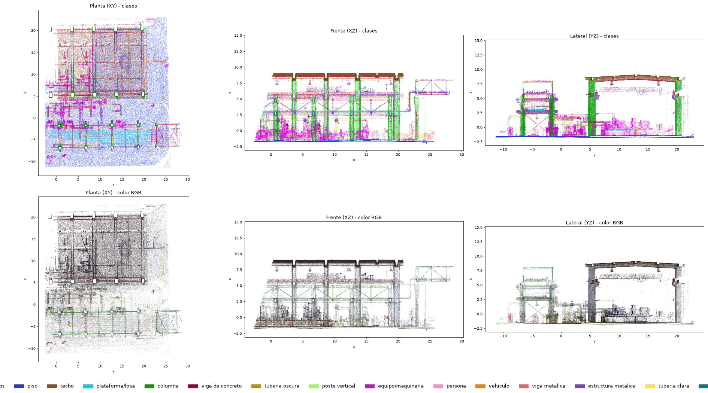

# Segmentación de una nube de puntos industrial mediante clustering en múltiples etapas

**Curso:** Machine Learning
**Integrantes:**
- Ríos Gómez, Valeria Valentina
- Diaz Flores, Nicolas Valentino
- Vega Napan, Bruno Gonzalo
- Cahuana Garcia, Luis Enrique 

---

## Resumen

Se segmenta un escaneo láser terrestre (FARO) de una planta industrial en sus elementos: piso, techo,
plataformas, columnas, vigas, tuberías, postes, equipos, estructuras metálicas, tanques, personas y
vehículos. El método combina **algoritmos de clustering no supervisado (DBSCAN y K-means) en nueve
etapas sucesivas** y utiliza los tres atributos disponibles de cada punto: **posición, color y
normal**. Cada etapa agrupa un subconjunto de puntos, asigna una clase a los grupos encontrados según
criterios geométricos o de color, y entrega a la siguiente etapa únicamente los puntos aún no
clasificados. El resultado es la nube original de 1.6 millones de puntos coloreada según 15 clases, con
un 3.3% de puntos sin clasificar.



*Figura 1. Nube segmentada (fila superior) y colores reales del escaneo (fila inferior), en planta,
frente y vista lateral.*

 ---

## Reproducibilidad

**Entorno.** Python 3.12 con las siguientes bibliotecas:

```bash
pip install open3d numpy scipy scikit-learn matplotlib
```

| Biblioteca | Uso |
|---|---|
| Open3D | Lectura, voxelizado, escritura y visualización de la nube |
| scikit-learn | DBSCAN y K-means |
| SciPy | Búsqueda de vecinos (árbol k-d) |
| matplotlib | Figuras |

**Ejecución.** Con el archivo `FARO_Scan_Full_Sub1_down3_with_normals.ply` en esta carpeta:

```bash
python segmentacion_nube.py           # segmentación y exportación de resultados
python segmentacion_nube.py --show    # además, visualización 3D con Open3D
python figuras.py                     # figuras de este documento
```

**Estructura del repositorio:**

```
tarea3/
├── segmentacion_nube.py      # implementación de las etapas de segmentación
├── figuras.py                # generación de las figuras
├── README.md
└── resultados/
    ├── nube_segmentada.ply   # nube segmentada, coloreada por clase
    ├── nube_segmentada.png   # vistas de la nube segmentada (figura 1)
    └── figuras/              # figuras
```

En [`segmentacion_nube.py`](segmentacion_nube.py), cada etapa corresponde a una función
(`stage_horizontal`, `stage_columns`, `stage_people`, `stage_point_types`, `stage_linear`,
`stage_color`, `stage_objects`, `smooth_labels`), y la función `run` las ejecuta en orden.
