# Segmentación de una nube de puntos industrial mediante clustering en múltiples etapas

**Curso:** Machine Learning
**Autor:** Luis Cahuana

---

## Resumen

Se segmenta un escaneo láser terrestre (FARO) de una planta industrial en sus elementos: piso, techo,
plataformas, columnas, vigas, tuberías, postes, equipos, estructuras metálicas, tanques, personas y
vehículos. El método combina **algoritmos de clustering no supervisado (DBSCAN y K-means) en nueve
etapas sucesivas** y utiliza los tres atributos disponibles de cada punto: **posición, color y
normal**. Cada etapa agrupa un subconjunto de puntos, asigna una clase a los grupos encontrados según
criterios geométricos o de color, y entrega a la siguiente etapa únicamente los puntos aún no
clasificados. El resultado es la nube original de 1.6 millones de puntos coloreada según 15 clases, con
un 3.3% de puntos sin clasificar.


*Figura 1. Nube segmentada (fila superior) y colores reales del escaneo (fila inferior), en planta,
frente y vista lateral.*

---

## Contenido

1. [Datos](#1-datos)
2. [Metodología](#2-metodología)
3. [Descripción de las etapas](#3-descripción-de-las-etapas)
4. [Resultados](#4-resultados)
5. [Evaluación](#5-evaluación)
6. [Limitaciones](#6-limitaciones)
7. [Reproducibilidad](#7-reproducibilidad)

---

## 1. Datos

La nube contiene **1,647,021 puntos** de una planta industrial de aproximadamente 30 × 35 m y 11 m de
altura. El eje z corresponde a la vertical: el piso se encuentra en z ≈ -1.6 m y el techo en z ≈ 9 m.
Cada punto tiene nueve atributos:

| Atributo | Descripción | Uso en el método |
|---|---|---|
| `x, y, z` | Posición en metros | Agrupamiento por proximidad; dimensiones, altura y forma de cada objeto |
| `red, green, blue` | Color (0–255) | Distinguir vigas pintadas de vigas de concreto, y tuberías claras de oscuras |
| `nx, ny, nz` | Vector normal unitario de la superficie | Distinguir superficies horizontales y verticales; reconocer secciones cilíndricas (tuberías y tanques) |

A partir de estos atributos se calculan, para cada punto, descriptores de su vecindario (sección 3,
etapa 1).

---

## 2. Metodología

### 2.1 Segmentación por capas

En una instalación industrial los elementos están físicamente conectados: las columnas tocan el piso y
el techo, las vigas se apoyan en las columnas y los equipos descansan sobre el piso. Un algoritmo
basado en densidad como DBSCAN, aplicado directamente sobre toda la nube, tiende por lo tanto a unir la
mayor parte de la escena en un único grupo.

Para evitarlo, la segmentación se organiza **por capas**. Cada etapa identifica un tipo de elemento, le
asigna su clase y retira esos puntos del conjunto de trabajo. Se extraen primero los elementos de mayor
tamaño y más fáciles de reconocer (piso, techo, columnas); al retirarlos, los elementos restantes dejan
de estar conectados entre sí y pueden separarse en las etapas posteriores.

Todas las etapas siguen el mismo esquema:

1. **Agrupar** un subconjunto de puntos con un algoritmo no supervisado (DBSCAN o K-means).
2. **Describir** cada grupo mediante medidas de tamaño, altura, forma y color.
3. **Asignar una clase** a cada grupo mediante criterios explícitos sobre esas medidas.

El clustering determina qué puntos pertenecen a un mismo objeto; los criterios de la tercera fase
determinan qué tipo de objeto es. El proceso es completamente automático: K-means se inicializa con
k-means++ y DBSCAN no requiere puntos semilla. Los parámetros de los algoritmos (`eps`, `minPts`, `K`) se
justifican a partir de los datos.

### 2.2 Resumen de las etapas

| Etapa | Algoritmo | Datos de entrada | Resultado |
|---|---|---|---|
| 0 | Voxelizado | Nube completa | Nube reducida (voxel de 8 cm) |
| 1 | PCA local | Vecindario de cada punto | Descriptores geométricos; elección de `eps` |
| 2 | **DBSCAN #1** | Puntos con normal vertical | Piso, techo, plataformas |
| 3 | **DBSCAN #2** (2D) | Superficies verticales, proyectadas en planta | Columnas |
| 4 | **DBSCAN #3** | Franja de 0 a 2.4 m sobre el piso | Personas y tanques |
| 5 | **K-means #4** | Descriptores de los puntos no clasificados | Tipo de punto: lineal, planar o disperso |
| 6 | **DBSCAN #5** | Posición y dirección principal | Vigas, tuberías y postes |
| 7 | **K-means #6 y #7** | Color de cada viga y cada tubería | Viga metálica / de concreto; tubería clara / oscura |
| 8 | **DBSCAN #8** | Puntos restantes | Vehículos, equipos, estructuras metálicas |
| 9 | Votación de vecinos | Nube completa | Etiquetas suavizadas y propagadas a los 1.6 M puntos |

---

## 3. Descripción de las etapas

### Etapa 0. Voxelizado

El espacio se divide en cubos de 8 cm y los puntos de cada cubo se reemplazan por su promedio de
posición, color y normal. La nube se reduce de 1,647,021 a **460,789 puntos**.

La separación media entre puntos del escaneo es de unos 3.3 cm. Un voxel de 8 cm reduce el volumen de
datos en un factor de 3.5, lo que permite ejecutar el proceso completo en unos 20 segundos, y conserva
el detalle de los elementos más delgados de interés (vigas y tuberías de 15 a 30 cm). Al finalizar,
cada punto original recibe la clase del punto voxelizado más cercano, de modo que el resultado se
entrega con la resolución original.

### Etapa 1. Descriptores locales

Para cada punto se calcula un **análisis de componentes principales (PCA)** de las posiciones de sus
vecinos. Sus autovalores, ordenados como l1 ≥ l2 ≥ l3, describen la forma del entorno:

| Descriptor | Definición | Valor alto en |
|---|---|---|
| Linealidad | (l1 − l2) / l1 | Vigas, tuberías, postes |
| Planaridad | (l2 − l3) / l1 | Paredes, losas, caras de equipos |
| Esfericidad | l3 / l1 | Bordes, ruido, objetos pequeños |
| Dirección principal | Primer autovector | Eje de una viga o tubería |
| Curvatura de normales | 1 − ‖promedio de las normales vecinas‖ | Superficies curvas o con muchas piezas |

Los descriptores de forma se calculan con **80 vecinos** (radio aproximado de 40 cm), ya que con un
radio menor una viga de 40 cm de ancho se percibe como un plano y no como un elemento lineal. La
curvatura se calcula con **25 vecinos** (aproximadamente 20 cm), escala suficiente para distinguir una
superficie lisa de una con muchas piezas.

#### Elección de `eps` mediante el gráfico de k-distancias

El radio de vecindad `eps` de DBSCAN se determina con el **gráfico de k-distancias**: para cada punto se
calcula la distancia a su k-ésimo vecino más cercano (k = `minPts`) y las distancias se ordenan. La
curva es casi plana para los puntos que pertenecen a una superficie y crece abruptamente para los
puntos aislados. Se toma como `eps` el **percentil 95**, valor a partir del cual la curva comienza a
crecer; con este radio, prácticamente todos los puntos de una superficie son puntos núcleo.

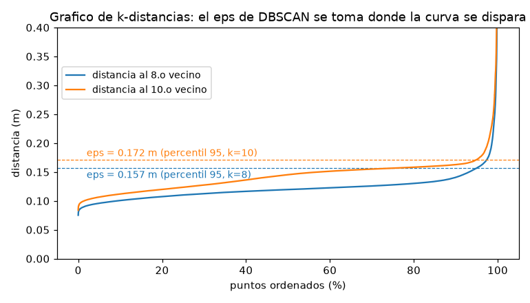

*Figura 2. Gráfico de k-distancias para k = 8 y k = 10.*

Se obtiene **`eps` = 0.157 m** para `minPts` = 8 y **`eps` = 0.172 m** para `minPts` = 10. Estos valores se
utilizan en los DBSCAN tridimensionales de las etapas 4, 6 y 8. Los DBSCAN de las etapas 2 y 3 operan en
espacios transformados (coordenada z escalada y proyección en planta, respectivamente), por lo que
emplean radios proporcionales al tamaño del voxel y de la celda.

### Etapa 2. Superficies horizontales (DBSCAN #1)

Se seleccionan los puntos cuya normal es casi vertical (|nz| > 0.9), es decir, los pertenecientes a
superficies horizontales, y se agrupan con DBSCAN en el espacio (x, y, 2.5·z). Escalar la coordenada z
aumenta la distancia efectiva entre superficies situadas a distinta altura y evita, por ejemplo, que
una plataforma baja se una al piso.

| Criterio | Clase |
|---|---|
| Superficie de mayor área | Piso |
| Área > 2 m² y altura a menos de 0.8 m del nivel más alto | Techo |
| Área > 3 m², ancho > 1.5 m y altura superior a la del piso | Plataforma/losa |

El ancho mínimo impide clasificar como plataforma la cara superior de una viga, que es horizontal
pero estrecha. Con los puntos del piso se construye además un **mapa de altura del piso**, que permite
calcular en las etapas posteriores la altura de cada punto sobre el suelo.

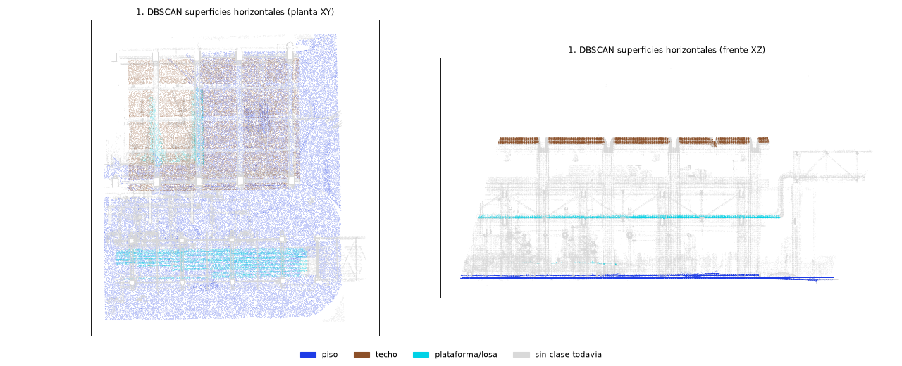

*Figura 3. Resultado de la etapa 2. En gris, los puntos aún no clasificados.*

### Etapa 3. Columnas (DBSCAN #2 en planta)

Se seleccionan los puntos de superficies verticales (|nz| < 0.3), se divide la planta en celdas de
10 cm y se mide, para cada celda, la altura total cubierta por dichos puntos. Las celdas que cubren
**3 m o más** se agrupan con **DBSCAN en dos dimensiones** (x, y).

En planta, una columna aparece como una región compacta que acumula varios metros de superficie
vertical. El análisis bidimensional permite detectarla aunque esté en contacto con vigas y equipos, que
en tres dimensiones la conectan con el resto de la estructura. Un grupo con huella de más de 0.4 m de
ancho y menos de 2 m de largo se clasifica como **columna**; una huella larga y estrecha, como muro. Se
identifican **19 columnas**; no se detectan muros de altura completa.

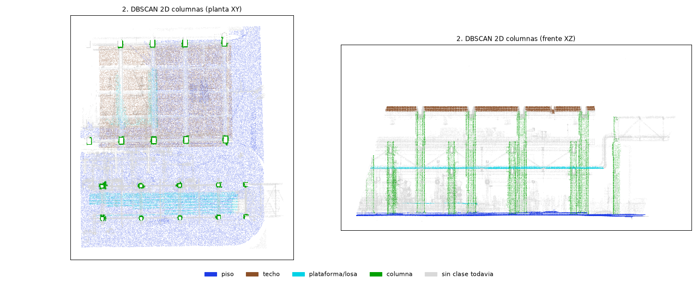

*Figura 4. Resultado de la etapa 3.*

### Etapa 4. Personas y tanques (DBSCAN #3)

Se aplica DBSCAN a los puntos no clasificados situados **entre 0 y 2.4 m sobre el piso**. Esta etapa
precede a la detección de elementos lineales porque una persona de pie también es un objeto vertical y
alargado, y de otro modo sería clasificada como poste.

Un grupo se considera candidato si cumple:

1. **Dimensiones humanas:** altura entre 1.3 y 2.1 m, huella contenida en 1.0 × 0.8 m y base apoyada
   en el piso.
2. **Aislamiento:** el número de puntos de otros objetos a menos de 50 cm no supera el número de puntos
   del propio grupo. Una persona está rodeada de espacio libre, mientras que un elemento de dimensiones
   similares adosado a un equipo no lo está.

Un candidato se clasifica como **tanque** si es un **cilindro vertical**: se ajusta un círculo a su
proyección en planta y se exige un radio de 0.15 a 0.6 m y que las normales apunten al eje (alineación
≥ 0.95). En caso contrario se clasifica como **persona**. Una persona no presenta una sección circular
regular: la mayor alineación observada entre las personas es 0.88, frente a 0.99 y 1.00 en los tanques.

Si un grupo tiene la altura de una persona pero excede su huella, como ocurre con dos personas próximas
entre sí, se vuelve a aplicar DBSCAN sobre ese grupo con un `eps` un 15% menor para separarlo.

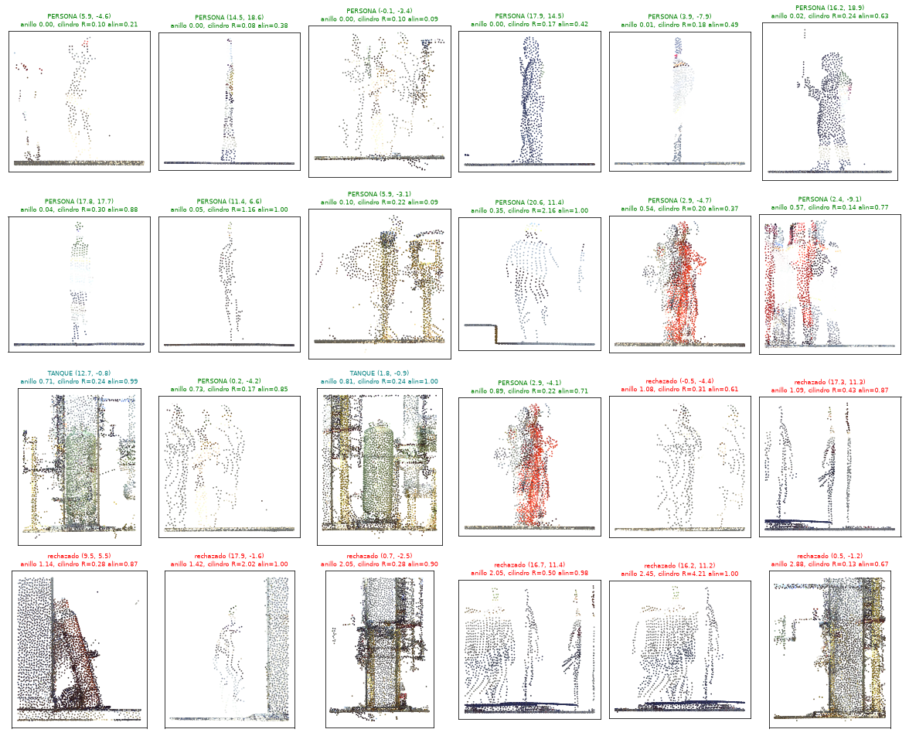

*Figura 5. Candidatos de la etapa 4 con su clasificación (verde: persona; turquesa: tanque; rojo:
rechazado) y sus medidas de aislamiento ("anillo") y de cilindricidad.*

Una parte de las personas aparece como **siluetas de pocos centímetros de espesor**. El escáner
registra la escena mediante un barrido rotatorio; cuando una persona se desplaza durante la captura,
solo queda registrado un perfil de su cuerpo. Estas siluetas se consideran personas.

### Etapa 5. Tipo de punto (K-means #4)

Se aplica K-means a seis descriptores de cada punto no clasificado: linealidad, planaridad,
esfericidad, componente vertical de la dirección principal, |nz| y curvatura. Cada grupo se nombra
según su centroide:

| Centroide | Tipo de punto |
|---|---|
| Esfericidad > 0.3 o curvatura alta | Disperso (bordes y ruido; se excluye de la etapa 6) |
| Linealidad > 0.45 | Lineal (vertical u horizontal) |
| En otro caso | Planar (vertical u horizontal) |

El número de grupos **K = 6** se elige con el **método del codo**: la inercia disminuye de forma
pronunciada hasta K = 6 y, a partir de ese valor, la reducción obtenida al añadir un grupo se reduce a
la mitad. El **coeficiente de silueta** se mantiene prácticamente constante (entre 0.27 y 0.33) para
todos los valores de K. Esto indica que los descriptores varían de forma continua y no forman grupos
claramente separados, por lo que la silueta no es un criterio discriminante en este caso.

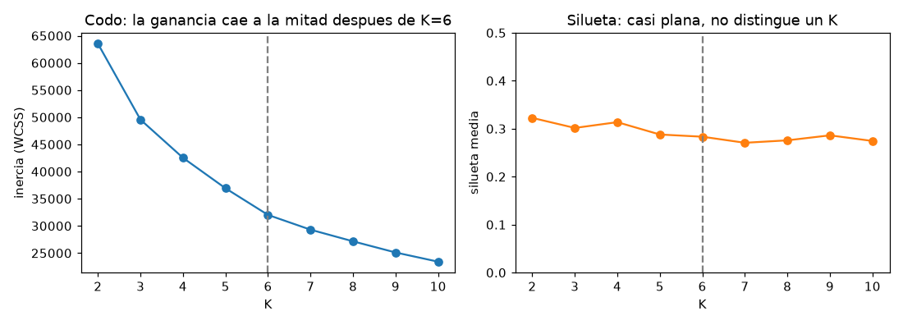

*Figura 6. Inercia y silueta media de K-means para K = 2 a 10.*

Como K-means es sensible a la escala de las variables, la curvatura se multiplica por 3 para que su
rango sea comparable al de los demás descriptores.

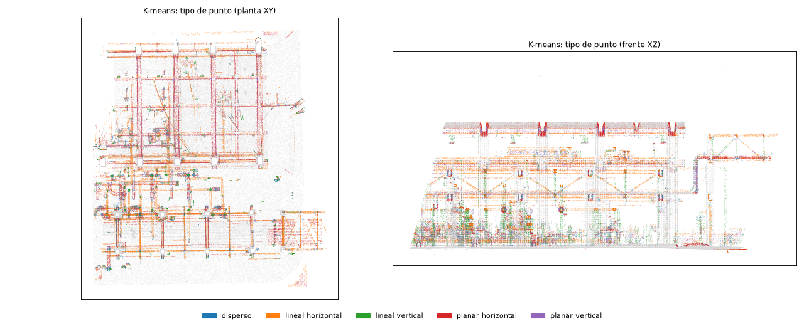

*Figura 7. Tipo de punto asignado por K-means.*

### Etapa 6. Vigas, tuberías y postes (DBSCAN #5)

Se aplica DBSCAN a los puntos no dispersos utilizando como atributos la **posición y la dirección
principal**. Incluir la dirección separa elementos que se cruzan, como dos vigas perpendiculares en
contacto. La dirección se representa mediante el producto exterior e·eᵀ, ya que un eje carece de
sentido: los vectores (1, 0, 0) y (−1, 0, 0) representan la misma dirección.

Se consideran segmentos lineales los grupos de al menos 1.5 m de longitud y con una longitud de al
menos tres veces su ancho. Para distinguir vigas de tuberías se analiza la **sección transversal** del
segmento, a la que se ajusta un círculo:

- en una **tubería**, la sección es circular: el error del ajuste es bajo y las normales apuntan al eje;
- en una **viga**, la sección está formada por caras planas y el círculo no la describe.

Un segmento se clasifica como **tubería** si el radio ajustado es menor que 0.6 m y el error relativo es
menor que 0.12, o menor que 0.18 con una alineación de las normales superior a 0.9. En caso contrario,
se clasifica como **poste** si su eje es vertical y como **viga** en los demás casos.

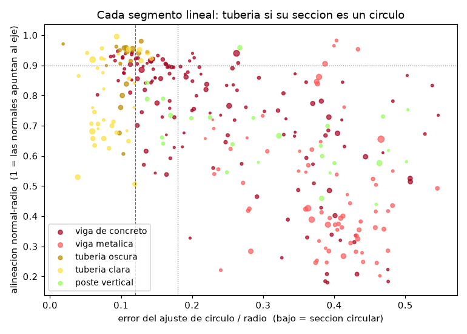

*Figura 8. Cada segmento según el error del ajuste de círculo y la alineación de sus normales; el
tamaño del marcador es proporcional al número de puntos. Las líneas indican los umbrales. Los segmentos
de viga de concreto situados en la región de tuberías corresponden a los bordes de las vigas del techo
reclasificados en la etapa 7.*

### Etapa 7. Color de vigas y tuberías (K-means #6 y #7)

Esta etapa utiliza el **color mediano** de cada segmento lineal.

**Vigas.** Se aplica K-means con K = 2 sobre el **croma**, definido como max(R,G,B) − min(R,G,B). El
croma mide la intensidad del color con independencia de su luminosidad. La estructura de acero está
pintada de rojo y verde (croma alto), mientras que el concreto es gris o marrón (croma bajo). El grupo
de mayor croma se clasifica como **viga metálica** y el otro como **viga de concreto**. Se utiliza el
croma y no la saturación o el brillo porque estas dos medidas agruparían las vigas según su luminosidad
(claras frente a oscuras) y no según su pintura.

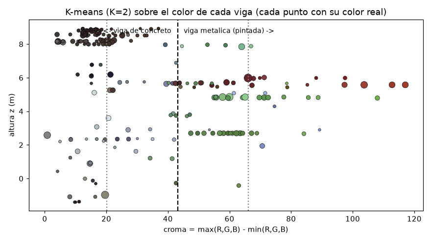

*Figura 9. Cada viga representada con su color real, según su croma y su altura. A la izquierda, las
vigas de concreto del techo (z ≈ 8.5 m); a la derecha, la estructura de acero roja y verde.*

**Tuberías.** Se aplica K-means con K = 2 sobre el **brillo**, max(R,G,B), que separa dos familias:
tuberías blancas o gris claro (**tubería clara**) y tuberías de acero oscuro (**tubería oscura**).

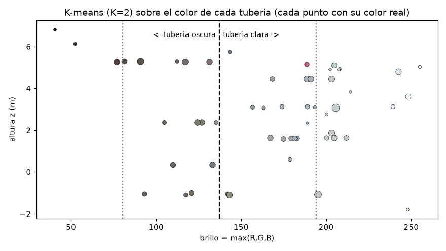

*Figura 10. Cada tubería representada con su color real, según su brillo y su altura.*

**Corrección por contexto.** Los segmentos clasificados como tubería oscura cuyo punto más alto se
encuentra a menos de 1.2 m del nivel del techo corresponden al **borde inferior de las vigas del
techo**. Son vigas estrechas (unos 20 cm) cuyo fondo, junto con sus dos aristas, describe un perfil
semejante a un arco que supera la prueba del círculo. Tienen además el mismo color marrón oscuro que el
techo. Estos segmentos se reclasifican como viga de concreto.

### Etapa 8. Objetos restantes (DBSCAN #8)

Se aplica DBSCAN a los puntos no clasificados. Cada objeto se describe mediante su huella (largo ×
ancho), su altura, la altura de su base sobre el piso y su curvatura mediana.

| Criterio | Clase |
|---|---|
| 3–6.5 × 1.3–2.6 × 1.0–2.6 m, base en el piso y curvatura mediana < 0.03 | Vehículo |
| Base a menos de 1 m del piso y al menos 150 puntos | Equipo/maquinaria |
| Base a 1 m o más del piso y extremo superior al nivel del techo | Techo (estructura de cubierta) |
| Base a 1 m o más del piso, sin alcanzar el techo | Estructura metálica |

El criterio de **curvatura** distingue un vehículo de un equipo de dimensiones similares: la carrocería
es una superficie lisa (curvatura mediana de 0.016), mientras que la maquinaria presenta numerosas
piezas, conductos y aristas (0.089). La clase **estructura metálica** agrupa los elementos de acero en
altura (cerchas, barandas y soportes), que en su mayoría no están pintados, por lo que se identifican
por su posición y no por su color.

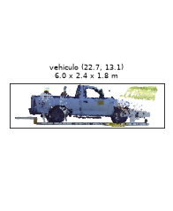

*Figura 11. Vehículo detectado. El escáner registra solo uno de sus lados.*

### Etapa 9. Suavizado y propagación

Cada punto adopta la clase mayoritaria entre sus 25 vecinos cuando esta reúne al menos el 60% de los
votos (dos iteraciones). El suavizado corrige puntos aislados en los bordes de los objetos.
Finalmente, cada punto de la nube original recibe la clase del punto voxelizado más cercano.

#### Evolución de la segmentación

| | |
|---|---|
| 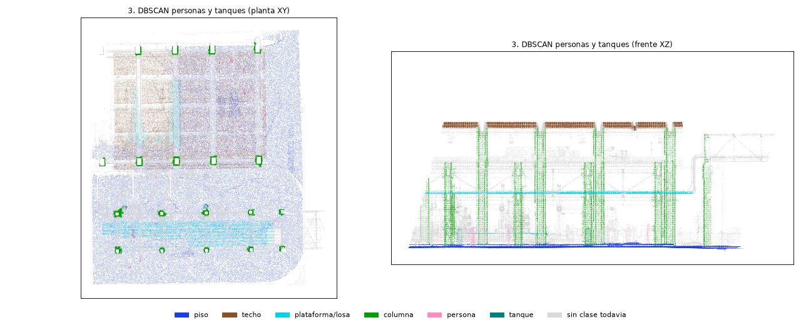 | 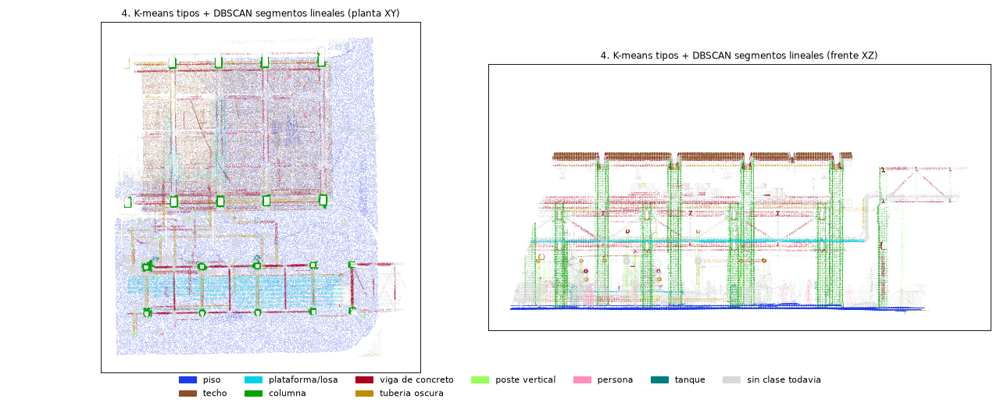 |
| 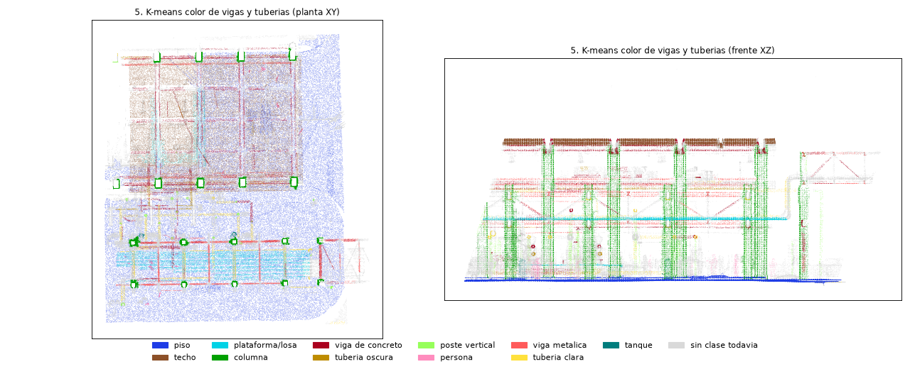 | 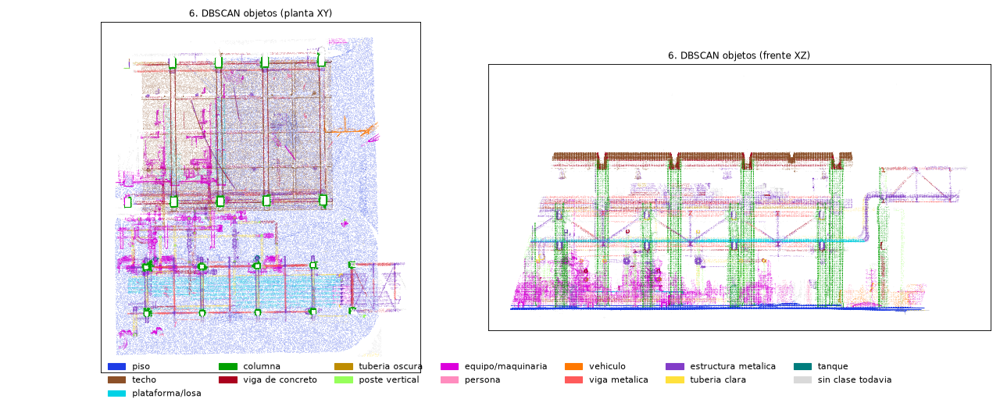 |


*Figura 12. Estado de la segmentación tras las etapas 4 a 9.*

---

## 4. Resultados

| Clase | Color | Puntos | % |
|---|---|---:|---:|
| Piso | azul | 468,264 | 28.4% |
| Columna | verde | 258,513 | 15.7% |
| Techo | marrón | 237,664 | 14.4% |
| Equipo/maquinaria | magenta | 186,529 | 11.3% |
| Estructura metálica | morado | 144,149 | 8.8% |
| Viga de concreto | granate | 90,240 | 5.5% |
| Plataforma/losa | cian | 67,193 | 4.1% |
| Viga metálica | rojo claro | 57,925 | 3.5% |
| Tubería clara | amarillo | 29,516 | 1.8% |
| Poste vertical | verde claro | 19,789 | 1.2% |
| Tubería oscura | ocre | 16,038 | 1.0% |
| Vehículo | naranja | 6,978 | 0.4% |
| Persona | rosa | 5,929 | 0.4% |
| Tanque | turquesa | 3,362 | 0.2% |
| **Sin clasificar** | gris | **54,932** | **3.3%** |

Se identifican 19 columnas, 14 personas, 2 tanques, 1 vehículo, 214 vigas (71 metálicas y 143 de
concreto), 54 tuberías (37 claras y 17 oscuras), 26 postes, 32 equipos y 91 estructuras metálicas.

La nube segmentada se entrega en `resultados/nube_segmentada.ply`. La carpeta `resultados/clases/`
contiene un archivo PLY por clase, que permite inspeccionar cada clase por separado en CloudCompare.

---

## 5. Evaluación

La nube no dispone de etiquetas de referencia, por lo que la evaluación global es cualitativa,
mediante inspección visual de cada etapa (figuras 3 a 12) y de la nube resultante en CloudCompare.

Para la clase **persona** se realizó una evaluación cuantitativa, revisando manualmente cada uno de los
24 candidatos de la figura 5:

| Medida | Resultado |
|---|---|
| Precisión (detecciones que corresponden a personas) | 13 / 14 = **93%** |
| Exhaustividad (personas observadas que fueron detectadas) | 13 / 18 = **72%** |

El único falso positivo corresponde a una válvula. Las cinco personas no detectadas son siluetas
situadas junto a columnas o equipos, que no cumplen el criterio de aislamiento. Los dos tanques
cilíndricos, cuyas dimensiones son similares a las de una persona, se clasifican correctamente.

El vehículo presente en la escena se detecta correctamente, y ningún equipo se clasifica como vehículo.

---

## 6. Limitaciones

1. **Personas en movimiento.** Las siluetas generadas por personas que se desplazaron durante el
   escaneo pueden corresponder a una misma persona registrada en distintos instantes, por lo que el
   número de detecciones no equivale necesariamente al número de personas distintas.
2. **Sensibilidad del vehículo al parámetro `eps`.** El vehículo está escaneado solo por uno de sus
   lados y se encuentra próximo a un muro bajo. Un `eps` mayor provocaría que DBSCAN uniera ambos
   objetos.
3. **Criterios específicos de la escena.** Los umbrales empleados para asignar clases (dimensiones,
   alturas, curvatura) están definidos para una instalación industrial; su aplicación a otro tipo de
   escena requeriría revisarlos.
4. **Clase estructura metálica.** Puede incluir objetos suspendidos de pequeño tamaño, como luminarias.
5. **Evaluación parcial.** Solo la clase persona cuenta con una evaluación cuantitativa; las demás se
   evaluaron visualmente.

---

## 7. Reproducibilidad

**Entorno.** Python 3.12 con las siguientes bibliotecas:

```bash
pip install open3d numpy scipy scikit-learn matplotlib
```

| Biblioteca | Uso |
|---|---|
| Open3D | Lectura, voxelizado, escritura y visualización de la nube |
| scikit-learn | DBSCAN y K-means |
| SciPy | Búsqueda de vecinos (árbol k-d) |
| matplotlib | Figuras |

**Ejecución.** Con el archivo `FARO_Scan_Full_Sub1_down3_with_normals.ply` en esta carpeta:

```bash
python segmentacion_nube.py           # segmentación y exportación de resultados
python segmentacion_nube.py --show    # además, visualización 3D con Open3D
python figuras.py                     # figuras de este documento
```

**Estructura del repositorio:**

```
tarea3/
├── segmentacion_nube.py      # implementación de las etapas de segmentación
├── figuras.py                # generación de las figuras
├── README.md
└── resultados/
    ├── nube_segmentada.ply   # nube segmentada, coloreada por clase
    ├── nube_segmentada.png   # vistas de la nube segmentada (figura 1)
    ├── clases/               # un archivo PLY por clase
    └── figuras/              # figuras 2 a 12
```

En [`segmentacion_nube.py`](segmentacion_nube.py), cada etapa corresponde a una función
(`stage_horizontal`, `stage_columns`, `stage_people`, `stage_point_types`, `stage_linear`,
`stage_color`, `stage_objects`, `smooth_labels`), y la función `run` las ejecuta en orden.
